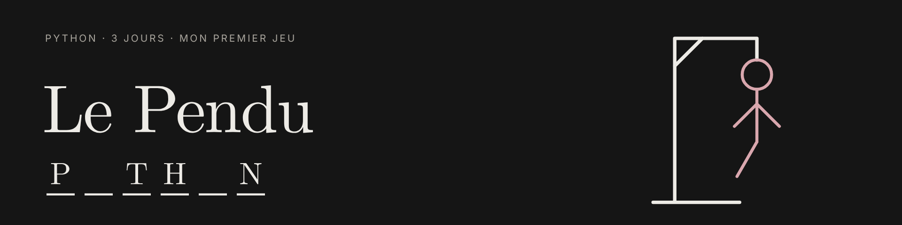

<p align="center">
  
</p>

<p align="center">
  
  
  <a href="https://najetzridette.github.io/#projets"></a>
</p>

> Mon premier jeu complet, réalisé **en 3 jours** pendant le Bootcamp Python d'Epitech.
> Une version web est jouable directement sur [mon portfolio](https://najetzridette.github.io/#projets).

## Les règles

| | |
| --- | --- |
| 🎲 | Le programme choisit un mot au hasard dans une liste de **300 mots** |
| 🔤 | À chaque tour, on propose **une lettre** ou **le mot entier** |
| ❌ | Lettre fausse : **1 pénalité** · mot faux : **5 pénalités** |
| 💀 | À **12 pénalités**, la partie est perdue |
| 🏆 | Le meilleur score (le moins de tentatives) est enregistré avec sa date |

Les accents sont acceptés : taper `e` révèle aussi `é`, `è` ou `ê`.

## Lancer le jeu

Il faut Python 3.

```bash
python3 pendu.py mots.txt
```

## Les fichiers

```
pendu/
├── pendu.py        Le jeu
├── mots.txt        La liste de 300 mots
└── highscore.txt   Créé automatiquement : les records (tentatives;date)
```

## Ce que j'ai appris

- Lire un fichier et nettoyer ses lignes (`open`, `strip`, compréhension de liste)
- Récupérer un argument en ligne de commande (`sys.argv`) et arrêter le programme (`sys.exit`)
- Gérer une erreur sans faire planter le programme (`try` / `except FileNotFoundError`)
- Tirer un mot au hasard (`random.choice`)
- Sauvegarder un record d'une partie à l'autre dans un fichier (`datetime`, mode `"a"`)
- Construire des messages avec les f-strings

---

<p align="center"><a href="https://najetzridette.github.io">Mon portfolio</a> · <a href="https://github.com/najetzridette">Mon GitHub</a></p>
